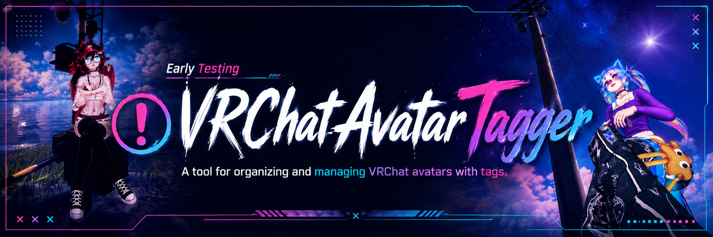
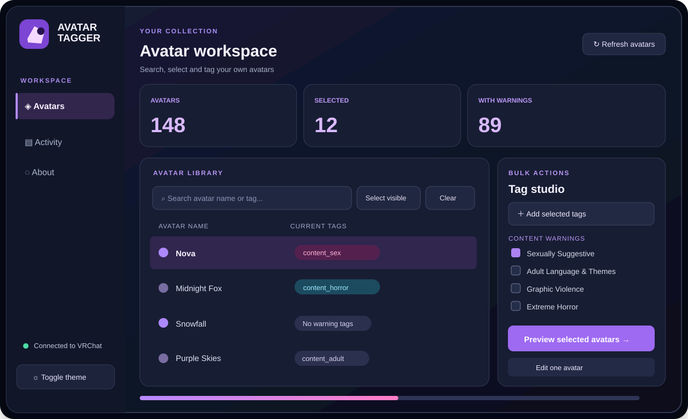

<p align="center">
  <a href="https://y2kbeatzz-dot.github.io/vrchat-avatar-tagger/" title="Open the official VRChat Avatar Tagger website">
    
  </a>
</p>

<p align="center">
  <a href="https://y2kbeatzz-dot.github.io/vrchat-avatar-tagger/"></a>
  <a href="https://github.com/y2kbeatzz-dot/vrchat-avatar-tagger/releases/latest"></a>
  <a href="https://github.com/y2kbeatzz-dot/vrchat-avatar-tagger/actions/workflows/release.yml"></a>
</p>

<p align="center">
  <a href="https://y2kbeatzz-dot.github.io/vrchat-avatar-tagger/"></a>
</p>

# VRChat Avatar Tagger

**Bulk manage your own VRChat avatar tags on macOS and Windows — preview first, then apply.**

**[🌐 Official Website](https://y2kbeatzz-dot.github.io/vrchat-avatar-tagger/)** · **[📦 All GitHub Releases](https://github.com/y2kbeatzz-dot/vrchat-avatar-tagger/releases)** · **[🐛 Issues & Support](https://github.com/y2kbeatzz-dot/vrchat-avatar-tagger/issues)**

A desktop app and command-line tool to bulk-manage [VRChat Content Warning tags](https://hello.vrchat.com/creator-guidelines) (Sexually Suggestive, Adult Language and Themes, Graphic Violence, Excessive Gore, Extreme Horror) to **all of your own avatars** at once, instead of clicking through each one individually on the VRChat website.

Useful if you have a large number of avatars and need to get them properly labeled to comply with VRChat's Creator Guidelines and upcoming Content Gating / Age Verification enforcement.

## What it does

- Logs into your VRChat account (supports email and authenticator 2FA)
- Fetches every avatar you own
- Adds the content warning tag(s) you choose to each avatar that doesn't already have them
- **Never removes** any existing tags, content-warning or otherwise

## About the creator

**Created by Ksyusha (Ксюша)** · [My profiles](https://guns.lol/life999)

### Why I made it

Managing a large VRChat avatar collection can mean opening the same pages repeatedly just to apply or adjust content-warning tags. I wanted a simpler way to select my own avatars, preview changes, and update the tags in a single place without accidentally touching unrelated tags.

### How I built it

VRChat Avatar Tagger is a Python project using the community `vrchatapi` client for authentication and avatar updates. The desktop UI was redesigned in **Qt / PySide6**, and **PyInstaller** packages it for macOS and Windows. GitHub Actions builds the releases, with custom macOS DMGs and a Windows setup wizard. Preview mode, individual edits, and resume controls are included so changes are easier to review and manage.

**[🌐 Project website](https://y2kbeatzz-dot.github.io/vrchat-avatar-tagger/)** · **[💜 Ksyusha's profiles](https://guns.lol/life999)** · **[📦 Releases](https://github.com/y2kbeatzz-dot/vrchat-avatar-tagger/releases)**

## v1.5.5 — Crash fix and faster avatar loading

**Mac crash resolved in the code:** The crash report showed Qt destroying a live FetchWorker. Closing during a network request now cancels safely and only exits after the worker finishes.

**Avatar library loads faster:** A shared 60-second delay was accidentally used for read-only avatar pages, adding a minute for every 100 avatars. The loader now uses a separate short read pause, displays the first page immediately, and updates its progress as more avatars arrive. Table repainting is throttled to improve responsiveness.

[**Download v1.5.5**](https://github.com/y2kbeatzz-dot/vrchat-avatar-tagger/releases/latest) to replace the older macOS app. Your existing locally saved session and progress data are preserved.

## v1.5.4 — Apply changes to VRChat

The desktop app now makes the distinction obvious: **Preview changes (no upload)** shows what would change without saving anything, while **Apply tags to VRChat** sends the selected updates after a confirmation dialog. The app counts a save as successful only when VRChat returns the expected tags. Failed or unconfirmed saves are reported clearly in Activity.

To apply: **select avatars → select the appropriate tags → click Apply tags to VRChat → confirm**. There is no longer a confusing preview-only checkbox to turn off.

The Avatar Library and Tag Studio panels are now resizable by dragging the divider; margins and sidebar spacing are reduced for smaller Mac screens. Bulk API requests are deliberately spaced to respect VRChat's rate guidance.

## v1.5.2 — UI navigation polish

The Qt desktop app adds **keyboard shortcuts** (⌘/Ctrl+F search, ⌘/Ctrl+R refresh, ⌘/Ctrl+1/2/3 navigation, F1 About), clearer tooltips and a status bar for tagging feedback. Branded Mac DMG installers, a Windows Setup wizard, and the portable Windows ZIP are available on the [GitHub Releases page](https://github.com/y2kbeatzz-dot/vrchat-avatar-tagger/releases/latest).

## v1.5.1 — A more polished, easier-to-use UI

This update improves the desktop app itself (not just the downloads):

- **Avatars look like avatars:** monogram thumbnails, readable color-coded tag chips, better spacing and selection highlighting.
- **Better sign-in experience:** branded two-column welcome screen with clear login fields.
- **Quick filters:** All avatars, With content warnings, Without content warnings, Has any tags, and Untagged.
- **More accessible controls:** the Tag Studio scrolls on smaller laptop screens.
- **Live progress in Activity:** follow the update and return to the avatar workspace without losing your selection.
- **Light and dark themes:** improved contrast, buttons, and readable selection states.

The **custom macOS DMG** (with branded drag-to-Applications artwork) and the **Windows setup wizard** (with install path, shortcuts and uninstaller) remain the recommended installers.

## New in v1.5: redesigned desktop interface

The desktop application has been rebuilt with **Qt (PySide6)** instead of the classic Tkinter look. It now includes a modern responsive desktop layout with **dark/light themes**, sidebar navigation, searchable avatar table, selection statistics, a dedicated **Tag Studio**, interactive progress, and an activity history view. Bulk updates, content warning/custom tags, individual avatar edits, 2FA, dry runs, stop, and resume still work.

<p align="center"></p>

*Illustrated UI preview, not a live account screenshot.*

### Custom installers

- **Mac Apple Silicon / Intel:** download the matching **branded DMG**. Open it and drag the app onto Applications inside the custom installer window.
- **Windows:** use the new **Setup EXE** for a custom wizard with your install folder, Start Menu shortcut, optional desktop icon, and uninstaller. A **portable ZIP** remains available.
- **From source:** `run_gui_mac.command` on macOS or `run_gui.bat` on Windows starts the new Qt UI in a private Python environment.

[**Download the latest release**](https://github.com/y2kbeatzz-dot/vrchat-avatar-tagger/releases/latest) · [**Official website**](https://y2kbeatzz-dot.github.io/vrchat-avatar-tagger/)

## GUI App (recommended)

If you'd rather not deal with the command line at all, use the desktop app version.

**macOS (Apple Silicon or Intel):** download the matching DMG from the [latest GitHub release](https://github.com/y2kbeatzz-dot/vrchat-avatar-tagger/releases/latest), open it, and drag **VRChat Avatar Tagger.app** into **Applications**. No Python installation is needed for release builds. These community builds are currently unsigned and not notarized; if macOS blocks launch, use **System Settings → Privacy & Security → Open Anyway** after confirming you trust the download.

**Windows:** use the [custom Setup EXE](https://github.com/y2kbeatzz-dot/vrchat-avatar-tagger/releases/latest) for guided installation, or download and extract the portable Windows ZIP. The `run_gui.bat` source launcher remains available.

**macOS/Linux (source install):** install Python 3 and use a private virtual environment:

```bash
python3 -m venv .venv
.venv/bin/python3 -m pip install -r requirements.txt
.venv/bin/python3 tag_avatars_qt.py
```

On Mac you can also use `run_gui_mac.command` (the first run installs the Qt and VRChat API dependencies). On Mac, app data is saved to `~/Library/Application Support/VRChat Avatar Tagger/` so packaged apps can run without writing into the app bundle.

**Website:** [VRChat Avatar Tagger Downloads](https://y2kbeatzz-dot.github.io/vrchat-avatar-tagger/) · [All Releases](https://github.com/y2kbeatzz-dot/vrchat-avatar-tagger/releases)

**Maintainers:** merges to `main` build macOS Apple Silicon custom DMG, macOS Intel custom DMG, Windows guided Setup EXE, and portable Windows ZIP with the project icon, then automatically create or update the version in `VERSION` under the repository’s **Releases** tab. To publish a new numbered release, update `VERSION` (and `RELEASE_NOTES.md`) in a commit to `main`. `.github/workflows/pages.yml` deploys the website when Pages is configured with **GitHub Actions** as its build/deployment source. Check Actions for build and deployment status.

The new Qt desktop app lets you:
- Log in (handles email/authenticator 2FA with a popup)
- Choose **Add** or **Remove** for the tags you pick — remove works exactly like add, just in reverse, and never touches other tags
- Check the box for each content warning tag you want to apply or remove
- Add any **custom tag** by typing it in, not just the 5 built-in content warnings
- See all your avatars in a searchable list and pick exactly which ones to affect (or "Select All")
- **Double-click any single avatar** to open its full tag list and add, remove, or fix individual tags on just that one avatar
- Set a limit on how many get changed in one run
- Preview with "Dry run" before applying anything for real
- **Resume automatically**: progress is saved to `tagger_progress.json` in the local application data directory as each avatar is updated, so if you stop a run (or the app closes) partway through, re-running the same tags/action skips whatever's already done. Uncheck "Resume" or hit "Clear saved progress" to start fresh.
- Watch a live log and progress bar while it runs, with a Stop button if you change your mind

<!-- Historical Tkinter screenshot retained as screenshot.png for archival reference. -->

## Command-line version

If you prefer the terminal or want to script/automate this, use `tag_avatars.py` instead.

### Install

```bash
pip install -r requirements.txt --break-system-packages
```

(or `pip install -r requirements.txt`)

### Usage

Always preview first with `--dry-run` — it prints exactly what would change without touching your account:

```bash
python3 tag_avatars.py --tags sex --dry-run
```

If that looks right, run it for real:

```bash
python3 tag_avatars.py --tags sex
```

Apply multiple tags at once:

```bash
python3 tag_avatars.py --tags sex,violence,gore
```

See all valid tag names:

```bash
python3 tag_avatars.py --list-tags
```

### Remove tags

Add `--remove` to remove the specified tag(s) instead of adding them (every other tag is left untouched):

```bash
python3 tag_avatars.py --tags sex --remove --dry-run
```

### Pick specific avatars

Instead of tagging every avatar, use `--select` to get a numbered list you can choose from:

```bash
python3 tag_avatars.py --tags sex --select
```

You'll see something like:

```
    1) Emma  [no tags]
    2) IRENE  [content_violence]
    3) Riptide  [content_sex]
Selection: 1,2,5-10
```

Type comma-separated numbers, ranges (`5-10`), or `all`.

### Cap how many get tagged

Use `--limit` to only tag the first N avatars that need it (handy for testing on a small batch first):

```bash
python3 tag_avatars.py --tags sex --limit 20
```

`--select` and `--limit` can be combined — `--limit` will cap however many you picked.

| Name       | VRChat label                  |
|------------|--------------------------------|
| `sex`      | Sexually Suggestive             |
| `adult`    | Adult Language and Themes       |
| `violence` | Graphic Violence                |
| `gore`     | Excessive Gore                  |
| `horror`   | Extreme Horror                  |

## Fixing a Mac certificate error during login

If the app displays **"Secure connection blocked"** or **`CERTIFICATE_VERIFY_FAILED`** when logging into VRChat, install the latest release. Starting with **v1.5.3**, Avatar Tagger verifies HTTPS connections using the native macOS Keychain trust store instead of relying on packaged Python certificate roots.

If you still see the error, your VPN, school/work network, antivirus, or HTTPS-filtering proxy might be presenting a certificate not trusted by your Mac. Check your system date/time, try a different trusted network, and ask the administrator to verify certificates on managed networks. **Do not turn off SSL verification or install unknown root certificates.** The app will not bypass certificate validation.

## Notes

The desktop app icon is generated by [`scripts/build_icons.py`](scripts/build_icons.py) as a native macOS `.icns`, Windows `.ico`, and PNG. The source design for README and website branding is [`assets/icon.svg`](assets/icon.svg).


- Your username/password are only used locally to log into VRChat's own servers, exactly like the website login. They're entered at runtime (never hardcoded) and nothing is sent anywhere besides VRChat's API.
- After a successful login, the tool saves a session file (`vrchat_session.cookies`) in its local application data directory (on macOS, `~/Library/Application Support/VRChat Avatar Tagger/`; in source checkouts on Windows/Linux, next to the script) so re-running it doesn't need a fresh login every time. **Don't share or commit this file** — it's as sensitive as being logged in. It's already excluded via `.gitignore`.
- If the avatar list cannot load, the GUI displays the error and writes technical
  details to `tagger_error.log` in its application data directory. Do not post that log publicly without checking it
  for account-related information first.
- VRChat limits how many login sessions and requests you can make in a short window. The script pauses briefly between requests; don't remove that.
- This uses [`vrchatapi`](https://github.com/vrchatapi/vrchatapi-python), an unofficial but actively maintained community wrapper around VRChat's API. It isn't officially supported by VRChat.

## License

MIT — see [LICENSE](LICENSE).
